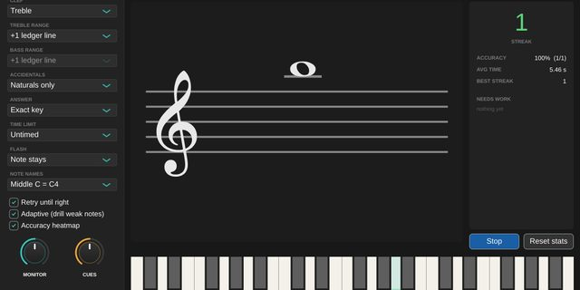
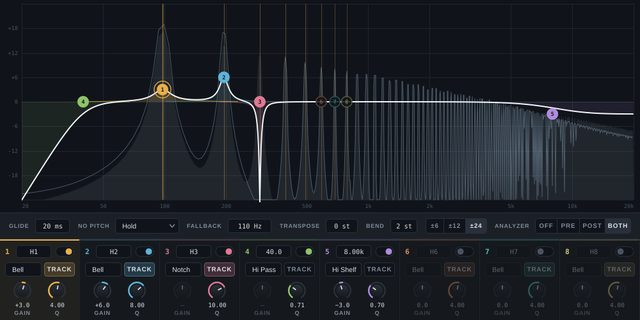

## Bands

::: {.card-grid}
::: {.music-card}
### Bovenburen

[Dutch pop band · drums]{.card-meta}

Pop songs in Dutch, played as a four-piece band.

::: {.link-row}
<a href="https://open.spotify.com/artist/7HjgUEerLzE2qboXJXfBJj"><i class="bi bi-spotify"></i> Spotify</a>
<a href="https://www.instagram.com/bovenburen/"><i class="bi bi-instagram"></i> Instagram</a>
<a href="https://bovenburen.com"><i class="bi bi-globe"></i> Website</a>
:::
:::

::: {.music-card}
### Flamingo Hitmix

[Electronic live dance act · keys]{.card-meta}

Available for live shows: book us or send me a message.

::: {.link-row}
<a href="https://www.instagram.com/flamingohitmix/"><i class="bi bi-instagram"></i> Instagram</a>
<a href="https://flamingohitmix.com"><i class="bi bi-globe"></i> Website</a>
:::
:::
:::

::: {.music-earlier}
Before these bands, I played in the electronic dub act Steppers for Mankind and the live house act Novio.
<a href="https://open.spotify.com/search/steppers%20for%20mankind"><i class="bi bi-spotify"></i> Steppers for Mankind</a>
:::

## Music software

I also make my own audio plugins for these projects. These days that is not hard anymore with the [JUCE](https://juce.com) framework and a solid LLM. All four are open source.

::: {.card-grid}
::: {.music-card .soft-card}

<i class="bi bi-lightbulb"></i>

### HitNoteDmx

Turns MIDI notes into a live DMX light show, so the lights can be played from Ableton sets with MIDI clips or like an instrument. This is what drives our light show for Flamingo Hitmix.

::: {.link-row}
<a href="https://github.com/joris-klingen/hitnotedmx"><i class="bi bi-github"></i> GitHub</a>
:::
:::

::: {.music-card .soft-card}

<i class="bi bi-grid-3x3-gap"></i>

### HitLaunchDmx

A standalone app that plays the same light show live without a DAW, from a Novation Launchpad and Launch Control.

::: {.link-row}
<a href="https://github.com/joris-klingen/hitlaunchdmx"><i class="bi bi-github"></i> GitHub</a>
:::
:::

::: {.music-card .soft-card}

### FlashRoll

A sight-reading trainer that flashes notes and chords on a staff and waits for you to play them on a MIDI keyboard.

::: {.link-row}
<a href="https://github.com/joris-klingen/flashroll"><i class="bi bi-github"></i> GitHub</a>
:::
:::

::: {.music-card .soft-card}

### HarmEQ

A harmonic EQ whose bands follow the pitch of the note being played, great for shaping bass sounds.

::: {.link-row}
<a href="https://github.com/joris-klingen/harmeq"><i class="bi bi-github"></i> GitHub</a>
:::
:::
:::
